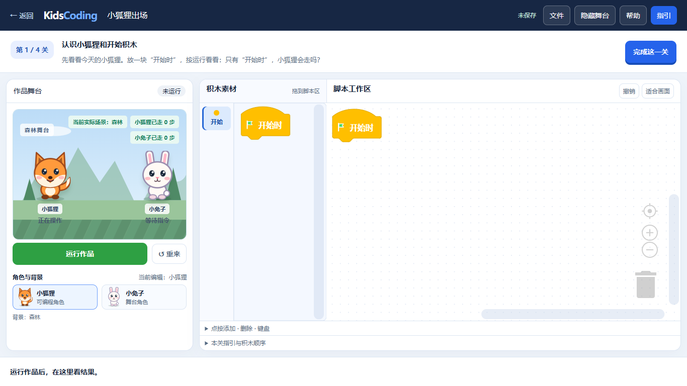

# OPS-049 视觉对照

左列为用户确认方向的 V3 HTML，右列为真实课堂的生产构建。所见均为第 1 关，脚本里已经加入开始积木。原型素材切到事件分类。实际课堂的积木由同一 Blockly 实例的 Zelos 和 flyout 绘制。

| 尺寸 | V3 原型 | 正式代码 |
| --- | --- | --- |
| 1440 × 900 |  |  |
| 1366 × 768 |  |  |
| 768 × 1024 |  |  |
| 375 × 812 |  |  |

原型提交、浏览器版本及边界坐标见 [bounds.json](bounds.json)。正式代码的素材列宽由分类和 Blockly 本身保留的 flyout 宽度组成，画布的 SVG 覆盖素材和脚本两列，脚本可编辑区域从 flyout 右边界开始。

桌面 1440 的有效三列宽约 393 / 266 / 743 px，1366 的有效三列宽约 372 / 252 / 703 px。两种尺寸三列比例均约 28% / 19% / 53%。

需要产品复核的差异：

- 桌面上素材与脚本共享相邻边线。单一 Blockly 实例负责跨列拖拽，区域不靠浮层切换。原型中的演示关卡圆点可跳关，正式课堂按原教案顺序解锁，任务带显示真实关卡、动作和完成入口。
- 舞台沿用仓库的森林、小狐狸和小兔子插画，位置与步数来自现有运行器。角色卡显示实际角色权限。原型里的移动积木数值样式是示意，样板的 100 步来自课程数据且不可编辑。
- 平板保留左侧舞台，右侧原生素材和脚本相邻，使触控拖拽不用跨过舞台。原型平板把素材放在舞台下。手机将舞台放在编辑区上方，素材和脚本相邻，分类在两者上方。原型手机把素材和脚本上下分开。两处差异均需要预发布实机确认。
- 文件菜单、保存状态、运行反馈和三层判定显示真实业务状态。反馈细节展开时限高，练习选择、实验及纠错沿用原数据。

样板的产品视觉结论、真人操作体验及预发布状态由独立审核和项目负责人确认。

本地生产构建和 TypeScript 通过。相关单测 455 条通过，专项 ESLint 0 错，2 条既有警告。真实 Chrome 样板与旧课堂回归 36 条及三视口工作区门禁 3 条通过，无失败、跳过或不稳定结果。失败注入验证覆盖本机存储、云端超时及导航备用入口。见 [浏览器结果](browser-results.json) 与 [第二课隔离复用](reuse.json)。
