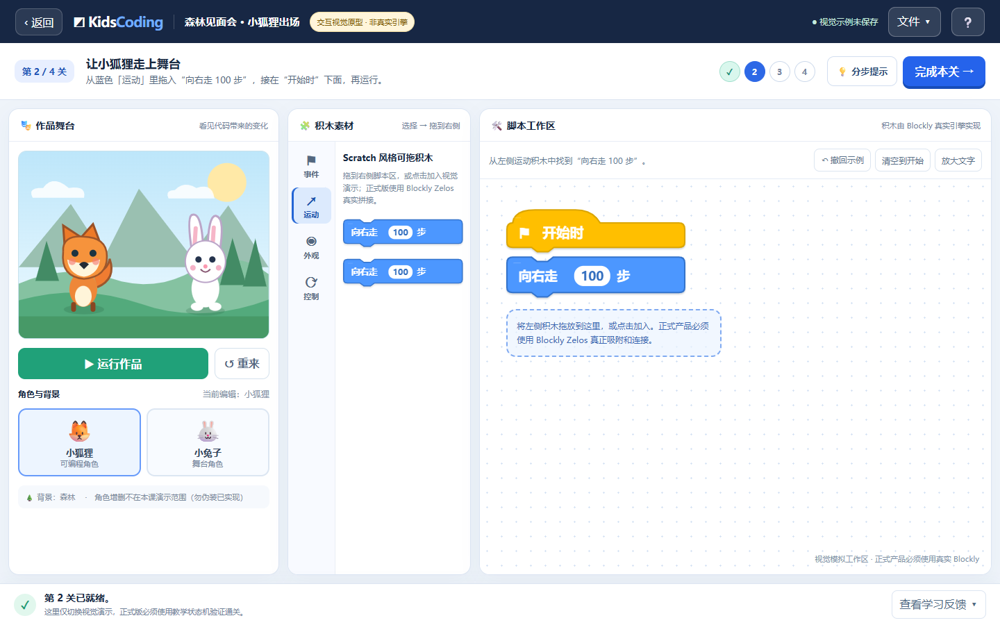
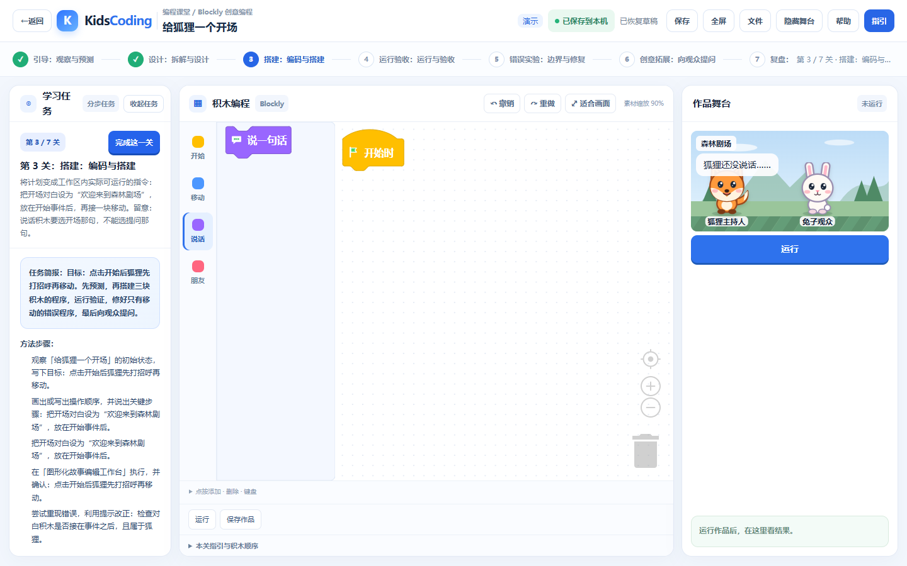
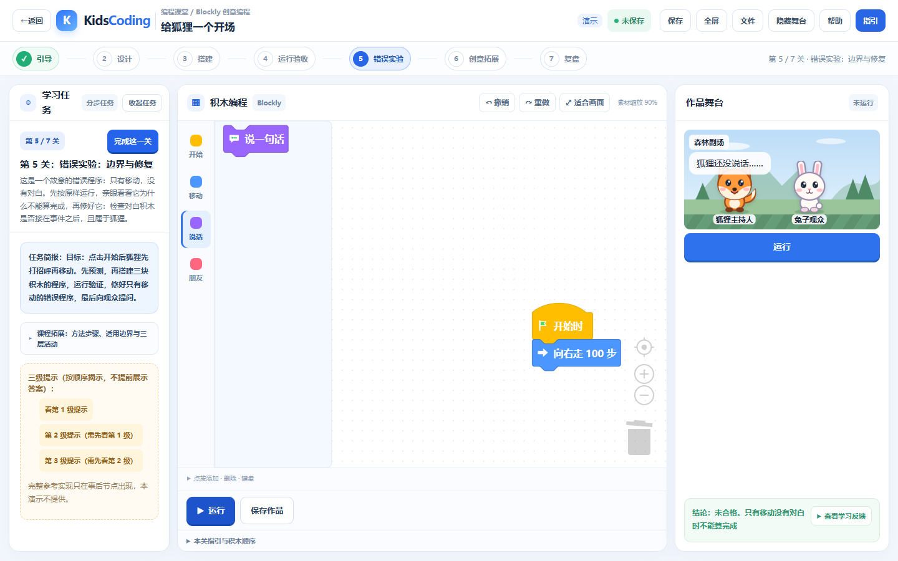
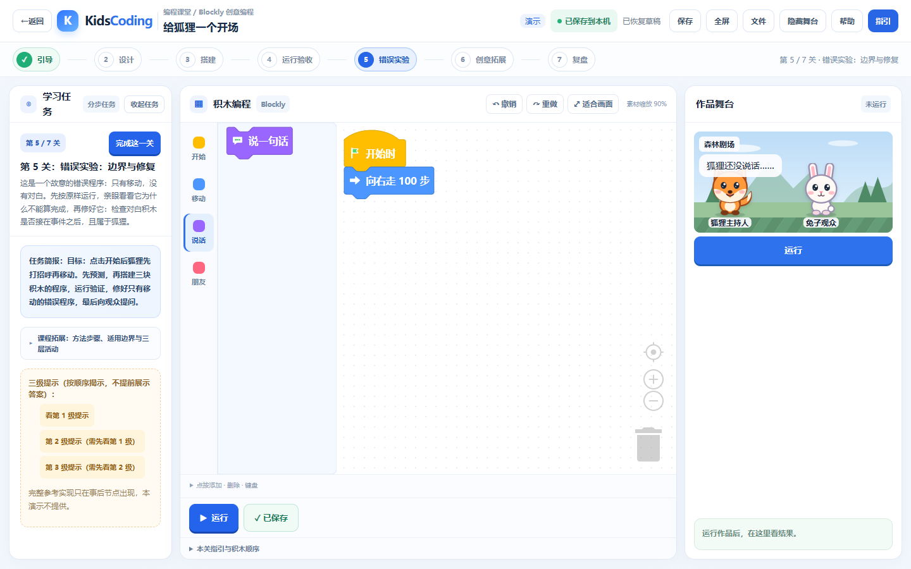
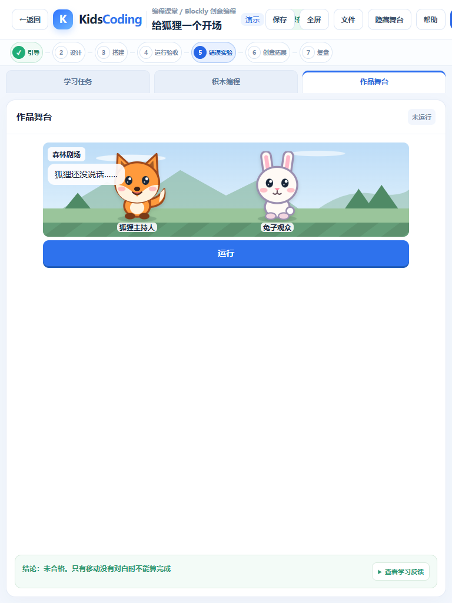
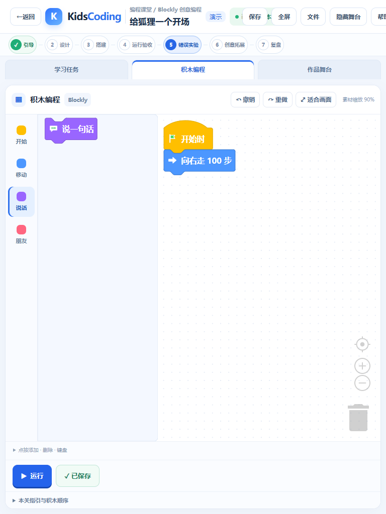
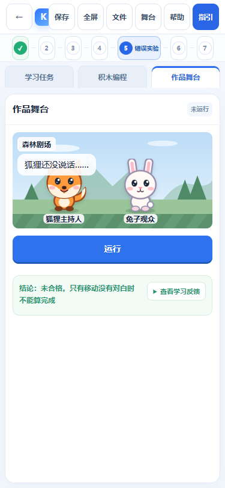
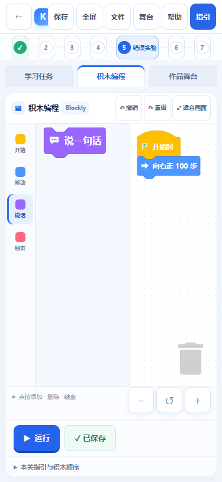

# OPS-049 视觉对照

左列为用户确认方向的 V3 HTML，右列为真实课堂的生产构建。两边都展示第 2 关。生产页面从第 1 关真实运行通关，再从常驻素材区拖入运动积木，Blockly 接上后执行，狐狸实际走了 100 步。原型仅供视觉对照。

| 尺寸 | V3 原型 | 正式代码：吸附后运行 | 松手前的真实拖拽 |
| --- | --- | --- | --- |
| 1440 × 900 |  |  | [鼠标](1440x900-drag.png) |
| 1366 × 768 |  |  | [鼠标](1366x768-drag.png) |
| 768 × 1024 |  |  | [触控](768x1024-drag.png) |
| 375 × 812 |  |  | [触控](375x812-drag.png) |

原型提交、浏览器版本及边界坐标见 [bounds.json](bounds.json)。正式代码的素材列宽由分类和 Blockly 本身保留的 flyout 宽度组成，画布的 SVG 覆盖素材和脚本两列，脚本可编辑区域从 flyout 右边界开始。

桌面 1440 的有效三列宽约 393 / 266 / 743 px，1366 的有效三列宽约 372 / 252 / 703 px。两种尺寸三列比例均约 28% / 19% / 53%。

平板实测场景宽约 477px，素材 245px，脚本 505px。手机场景宽 341px，素材 186px，脚本 171px。步骤二触控拖拽在平板横向移动约 189px、手机约 184px，两者纵向均约 66px。

需要产品复核的差异：

- 桌面上素材与脚本共享相邻边线。单一 Blockly 实例负责跨列拖拽，区域不靠浮层切换。原型中的演示关卡圆点可跳关，正式课堂按原教案顺序解锁，任务带显示真实关卡、动作和完成入口。
- 舞台沿用仓库的森林、小狐狸和小兔子插画，位置与步数来自现有运行器。角色卡显示实际角色权限。原型里的移动积木数值样式是示意，样板的 100 步来自课程数据且不可编辑。
- 平板采用两行。舞台上排和运行、角色卡并列，素材与脚本在下排相邻。原型把舞台放在素材上方并与脚本并排。平板布局已通过初审。手机在舞台下保留相邻的素材和脚本，原型手机把这两区上下分开。两种窄屏都用 Chrome 触控指针验证拖拽、连接及运行，最终仍需预发布实机确认。
- 平板原先约 200px 宽的舞台使状态文字落到角色身上。当前使用宽舞台保留场景与两只角色的实时步数。手机精简场景标签，三条状态保留。浏览器断言检查初始与移动后角色及标签实际矩形不相交。
- 文件菜单、保存状态、运行反馈和三层判定显示真实业务状态。反馈细节展开时限高，练习选择、实验及纠错沿用原数据。
- 手机缩放移到分类右侧，三枚 44×44px 触控按钮调用同一 Blockly 工作区。`bounds.json` 的 `mobileZoom` 记录拖拽前、松手前及吸附后的积木和按钮矩形。三个阶段中，缩放按钮与开始或运动积木的最小垂直间距约 11px。触控测试检查按钮中心及四个内边缘的命中结果，并实际操作分类、缩放、撤销、适合画面、顶栏和文件菜单。保存后课程名可省略以容纳操作。

样板产品状态保持 HOLD。课程 CI 环境修复、4 号独立审核和预发布实际用户体验仍是交付条件。

手机整改后复跑本地生产构建、TypeScript 和修改文件的 ESLint（0 错误、1 条既有未用参数警告）。455 条相关单测通过。真实 Chrome 的样板与旧课堂回归 40 条及三视口门禁 3 条全部通过。四视口运行和取证均用同一生产构建。故障注入覆盖本机存储、云同步超时、重试和导航备用入口。见 [浏览器结果](browser-results.json) 与 [第二课隔离复用](reuse.json)。

课程全量 CI 的 [Chrome 安装失败日志](https://github.com/HelloMrDuan/kidsCoding/actions/runs/44443329275/job/135289319251) 显示首次安装超时后 `apt-get` 仍持有 `dpkg` 锁，重试在课程测试执行前退出。共享安装流程由 [SYS-123](https://github.com/HelloMrDuan/kidsCoding/pull/560) 独立修复和验证。

## G1 复用 G0 V3 步骤与辅助区（2026-11-22，#573 审查整改）

G1《给狐狸一个开场》保留原七关的教学内容、判定、作品保存和 `data-testid`，视觉结构改为复用 G0 已批准的 V3 组件：顶部关卡条使用同样的步骤圆点（已完成 ✓、当前 `is-active`），任务卡使用同样的进度徽标、标题/指令分区和完成按钮；画布下方的旧版长说明、对白提醒、积木顺序、反思与运行日志收进同一可折叠辅助区，运行与保存常驻画布下方。手机端沿用 V3 的收敛规则：非当前关只留圆点，当前关保留截断标题。

截图取自同一生产构建的真实 Chrome。草稿预先写入第 1、2 关已通过、当前第 3 关，因此圆点同时展示已完成与当前状态。

| 尺寸 | 步骤条与任务卡 | 展开辅助区 / 编辑器 |
| --- | --- | --- |
| 1440 × 900 |  | [辅助区展开](g1-1440x900-details.png) |
| 375 × 812 |  | [手机编辑器](g1-375x812-editor.png) |

## G1 课堂收口：七关按钮、主次运行、折叠教案、账号隔离（2026-11-22）

本节记录 #573 收口整改的实测结果。证据均来自同一份 `next build --webpack`
生产构建，由 `next start` 在 127.0.0.1:3123 启动后，用 Playwright 驱动本机真实
Chrome（`channel: 'chrome'`）采集；未使用旧构建或原型。

**七关导航统一为 V3 步骤按钮。** 七关各自是真实的 `<button>`，不再是排成一行
的裸文字。1440×900、768×1024、375×812 三档都断言：按钮有可见边框、白色胶囊
底色、≥8px 圆角和 ≥36px（≤670px 时 ≥40px）点击高度；第 7 关右边界不超过步骤条
右边界，即不裁切、不横向溢出。当前关 `is-active`（蓝）、未完成（白）、已完成
`is-complete`（绿 + ✓）三态颜色互不相同；hover 背景真实变化；Tab 能到达关卡按钮
且 `:focus-visible` 画出 ≥2px 实线焦点环。关卡标题很长（如「运行验收：运行与验收」），
胶囊只显示「：」前的短名，完整标题保留在 `title`、`aria-label` 与任务卡标题中。
点击第 5 关后标题与 `is-active` 同步迁移；在第 1 关点「完成这一关」后该关立即变为
绿色 ✓，且该进度会写进草稿，刷新后仍在。

**运行 / 保存是清晰的主次按钮。** 「运行」为 V2 蓝色主按钮（`rgb(36, 99, 235)`、
白色文字、≥44px 高、圆角 ≥9px），「保存作品」为白底描边次按钮，两者间距 ≥6px；
hover 与键盘焦点环都实测。点击运行会真实进入 `data-running="true"`，一帧播完后
恢复「运行」并给出「未合格」结论；保存后按钮进入 `data-save-state="saved"` 并显示
「已保存」，本机草稿里确有该关 2 块积木；刷新后回到第 5 关、按钮可再次运行，页面
无横向溢出。

**左侧任务区默认只展示当前关。** `ws-task-content` 首屏显示当前关的「任务简报」；
方法步骤、适用边界与三层活动收进 `ws-task-extras` 折叠卡，默认关闭，展开后可见
`ws-method-steps` 与分级提示，收起不丢状态。

**guest:A / guest:B 学习记录隔离。** 编程课堂按草稿 owner 读取（`kc-progress-owner-v1`
认领戳 + owner-scoped 草稿键，失败即拒读）：A 的进度不会被 B 读到，B 也不会删除
A 的数据；未登录时旧的无主进度只允许 guest 认领一次。单测与真实浏览器
`lesson-workspace.spec.ts` 的「account isolation」用例在 desktop/tablet/mobile
三个项目均通过。

**21 块长脚本真实删除测试保留。** `lesson-workspace.spec.ts` 的 OPS-049 用例未删减，
本轮再次在 desktop / tablet / mobile 三项目全部通过（展开工具抽屉、重新测量命中、
断言 `blocklySelected` 后删除 1 块，计数从 21 变 20）。

本机命令与结果（2026-11-22）：

| 检查 | 命令 | 结果 |
| --- | --- | --- |
| 单测 | `npx vitest run`（classroom-entry、g1-u1-l01-slot、lesson-contract、lesson-workspace） | 4 文件 / 56 用例通过 |
| 课堂 E2E | `npx playwright test --config=playwright.workspace.local.config.ts` | 127 通过 / 2 跳过 / 0 失败（3.0m 前次、2.5m 本轮；跳过均为按设计的桌面/平板互斥用例） |
| 三视口 UI | `npx playwright test --config=playwright.g1.local.config.ts` | 3 通过（1440×900、768×1024、375×812），连续两次一致 |
| G1 旧回归 | `g1-golden-story.spec.ts` | 10 通过 |
| G1 经典课堂 | `g1-u1-l01-workspace.spec.ts` | 11 通过 / 11 跳过（按项目互斥） |
| 静态检查 | ESLint 修改文件 | 0 错误 / 2 条既有 `react-hooks` 警告 |
| 生产构建 | `npx next build --webpack` | 成功，48/48 静态页，TypeScript 检查通过 |

三视口截图（同一构建，运行后与刷新恢复后）：

| 尺寸 | 运行与判定 | 刷新恢复 |
| --- | --- | --- |
| 1440 × 900 |  |  |
| 768 × 1024 |  |  |
| 375 × 812 |  |  |

构建说明：本机 Node 22.22.3 的递归 `fs.cpSync` 在含中文路径的工作区报
`EIO, Access is denied`，`npm run build` 的 prebuild 拷贝脚本因此无法在本机运行
（CI 的 Linux 环境不受影响，仓库构建脚本未改）。本机先用 POSIX `cp` 完成
`public/blockly-media` 拷贝，再执行 `npx next build --webpack` 生成生产构建；上述
E2E 与截图全部针对该构建。本地 3100/3123 的旧 `next start` 进程不作为证据。
