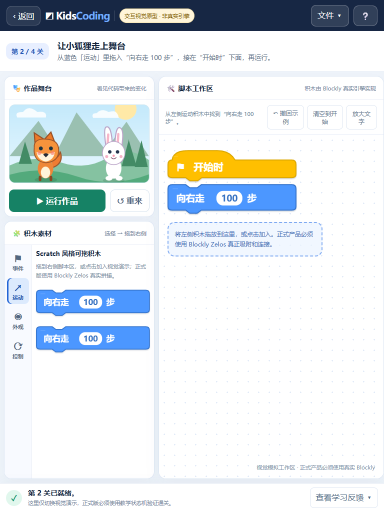
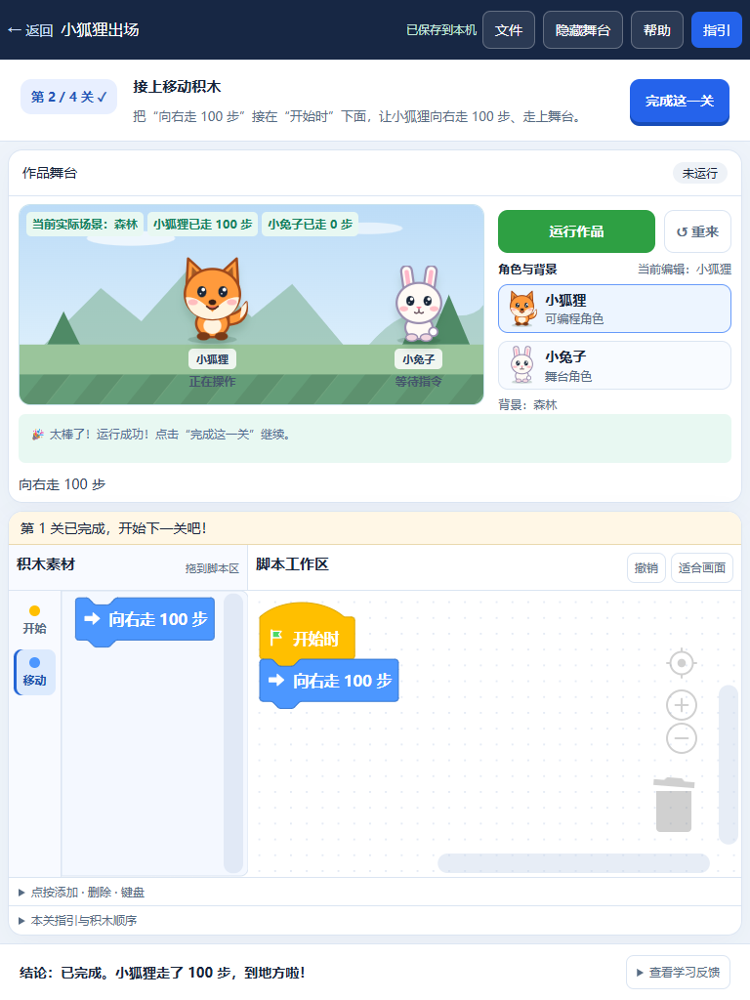

# OPS-049 视觉对照

左列为用户确认方向的 V3 HTML，右列为真实课堂的生产构建。两边都展示第 2 关。生产页面从第 1 关真实运行通关，再从常驻素材区拖入运动积木，Blockly 接上后执行，狐狸实际走了 100 步。原型仅供视觉对照。

| 尺寸 | V3 原型 | 正式代码：吸附后运行 | 松手前的真实拖拽 |
| --- | --- | --- | --- |
| 1440 × 900 |  |  | [鼠标](1440x900-drag.png) |
| 1366 × 768 |  |  | [鼠标](1366x768-drag.png) |
| 768 × 1024 |  |  | [触控](768x1024-drag.png) |
| 375 × 812 |  |  | [触控](375x812-drag.png) |

原型提交、浏览器版本及边界坐标见 [bounds.json](bounds.json)。正式代码的素材列宽由分类和 Blockly 本身保留的 flyout 宽度组成，画布的 SVG 覆盖素材和脚本两列，脚本可编辑区域从 flyout 右边界开始。

桌面 1440 的有效三列宽约 393 / 266 / 743 px，1366 的有效三列宽约 372 / 252 / 703 px。两种尺寸三列比例均约 28% / 19% / 53%。

平板实测场景宽约 477px，素材 245px，脚本 505px。手机场景宽 341px，素材 186px，脚本 171px。步骤二触控拖拽在平板横向移动约 189px、手机约 184px，两者纵向均约 66px。

需要产品复核的差异：

- 桌面上素材与脚本共享相邻边线。单一 Blockly 实例负责跨列拖拽，区域不靠浮层切换。原型中的演示关卡圆点可跳关，正式课堂按原教案顺序解锁，任务带显示真实关卡、动作和完成入口。
- 舞台沿用仓库的森林、小狐狸和小兔子插画，位置与步数来自现有运行器。角色卡显示实际角色权限。原型里的移动积木数值样式是示意，样板的 100 步来自课程数据且不可编辑。
- 平板采用两行。舞台上排和运行、角色卡并列，素材与脚本在下排相邻。原型把舞台放在素材上方并与脚本并排。手机在舞台下保留相邻的素材和脚本，两种窄屏都用 Chrome 触控指针验证拖拽、连接及运行。原型手机把素材和脚本上下分开。两处差异均需要预发布实机确认。
- 平板原先约 200px 宽的舞台使状态文字落到角色身上。当前使用宽舞台保留场景与两只角色的实时步数。手机精简场景标签，三条状态保留。浏览器断言检查初始与移动后角色及标签实际矩形不相交。
- 文件菜单、保存状态、运行反馈和三层判定显示真实业务状态。反馈细节展开时限高，练习选择、实验及纠错沿用原数据。
- 手机多项控件同时显示时空间仍紧凑。实拍中原生 Blockly 缩放控件可与积木右端在同一视区，课程名保存后可能以省略号显示。已验证素材拖拽、脚本吸附、运行、保存与反馈，需结合预发布真机体验评价控件密度。

样板产品状态保持 HOLD。课程 CI 环境修复、4 号独立审核和预发布实际用户体验仍是交付条件。

本地生产构建、TypeScript 及修改文件的 ESLint 通过。455 条相关单测通过，最后复跑共享舞台和课堂插槽等 149 条单测。真实 Chrome 的样板与旧课堂回归 40 条及三视口门禁 3 条全部通过。故障注入覆盖本机存储、云同步超时、重试和导航备用入口。见 [浏览器结果](browser-results.json) 与 [第二课隔离复用](reuse.json)。

课程全量 CI 的 [原始运行与重跑](https://github.com/HelloMrDuan/kidsCoding/actions/runs/44274830863) 有 Chrome 安装失败。首次安装超时后 `apt-get` 仍持有 `dpkg` 锁，重试在测试执行前退出。共享安装流程须另行登记并验证，OPS-049 保留全部测试与既有工作流。
